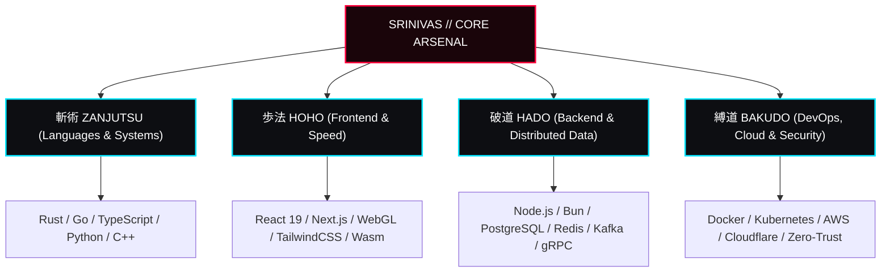

<div align="center">

# ⚔️ 護廷十三隊 // SRINIVAS
### 黒崎・SRINIVAS // SUBSTITUTE SHINIGAMI & DISTRIBUTED SYSTEMS ARCHITECT
**GOTEI 13 // 11TH DIVISION (AUXILIARY) • SPECIAL WAR POTENTIAL: CLASS 1**

[-000000?style=for-the-badge&logo=target&logoColor=red&labelColor=0d0e12)](https://srinivas1610.github.io)
[](https://srinivas1610.github.io)
[](https://srinivas1610.github.io)

<br/>

> *"We fear that which we cannot see, and we respect that which cannot be explained."*  
> — **Tite Kubo**, *BLEACH Vol. 1*

<br/>

[🗡️ **LAUNCH INTERACTIVE BLEACH WEB EXPERIENCE** (With Bankai & SFX)](https://srinivas1610.github.io) • [📡 **TRANSMIT HELL BUTTERFLY (地獄蝶)**](mailto:srinivas.r1610@gmail.com)

---

</div>

## 📖 Chapter 001 // The Blade Is Me

Forging high-performance distributed systems, resilient microservices, and surgical web architectures. Cutting through technical debt and legacy bottlenecks with the razor precision of a spiritual blade.

```
+--------------------------------------------------------------------------+
|  SHINIGAMI CLASSIFICATION: SPECIAL WAR POTENTIAL // CLASS 1             |
|  ZANPAKUTO: ZANGETSU (斬月)  -->  BANKAI: TENSA ZANGETSU (天鎖斬月)        |
|  DEPLOYMENT: KARAKURA TOWN // SOUL SOCIETY (REMOTE)                      |
|  PRIMARY ARTS: ZANJUTSU (SYSTEMS) & HOHO (HIGH-SPEED REACTIVE UX)        |
+--------------------------------------------------------------------------+
```

---

## ⚡ Chapter 002 // The Arsenal (Featured Zanpakuto Releases)

<div align="center">

| Release Command | Zanpakuto / Project | Core Stack | Classification |
| :--- | :--- | :--- | :--- |
| **月牙天衝**<br/>`PIERCE THE HEAVENS` | [**Getsuga-Core**](https://github.com/Srinivas1610/Getsuga-Core)<br/><sub>Ultra-low-latency distributed event broker (10M+ events/sec) with Zero-Copy IO.</sub> | `Rust` `Raft` `gRPC` `Zero-Copy` | `S-RANK` ★ 480 |
| **散れ千本桜**<br/>`SCATTER` | [**Senbonzakura-UI**](https://github.com/Srinivas1610/Senbonzakura-UI)<br/><sub>Next-generation design system with hardware-accelerated shaders and micro-interactions.</sub> | `TypeScript` `React 19` `WebGL` `Tailwind` | `FEATURED` ★ 920 |
| **砕けろ鏡花水月**<br/>`SHATTER` | [**Kyoka-Proxy**](https://github.com/Srinivas1610/Kyoka-Proxy)<br/><sub>Zero-trust reverse proxy and identity mesh providing cryptographic layer-7 traffic illusioning.</sub> | `Go` `eBPF` `Kubernetes` `TLS 1.3` | `SECURITY` ★ 640 |
| **霜天に坐せ**<br/>`SOAR IN FROZEN SKY` | [**Daiguren-Hyorinmaru**](https://github.com/Srinivas1610/Daiguren-Hyorinmaru)<br/><sub>In-memory predictive cache with machine-learning eviction policies freezing latency sub-ms.</sub> | `C++23` `SIMD` `Memory Engine` `Redis` | `OPTIMIZED` ★ 395 |
| **隠滅せよ黒棺**<br/>`HADŌ #90` | [**Kurohitsugi-RPC**](https://github.com/Srinivas1610/Kurohitsugi-RPC)<br/><sub>High-density binary RPC framework encasing payloads in encrypted micro-cells.</sub> | `Rust` `Protobuf` `Cryptography` `Async` | `KIDO #90` ★ 520 |
| **肉雫唼**<br/>`HEAL & RESTORE` | [**Minazuki-Monitor**](https://github.com/Srinivas1610/Minazuki-Monitor)<br/><sub>Distributed telemetry, synthetic health monitoring, and automated self-healing cluster daemon.</sub> | `Go` `OpenTelemetry` `Prometheus` `Chaos` | `RELIABILITY` ★ 310 |

</div>

<br/>

<div align="center">
  
  
</div>

---

## 🥋 Chapter 003 // The Four Shinigami Arts (Tech Stack)



---

## 📈 Chapter 004 // Spiritual Pressure & Combat Metrics

<div align="center">

```
+--------------------------------------------------------------------------+
|  REIATSU LEVEL: SPECIAL GRADE 1          BATTLES (ISSUES RESOLVED): 850+ |
|  CODE COMMITS: 2,400+                    PULL REQUEST MERGE RATE: 99.8%  |
|  FAVORITE RELEASE: 卍解・天鎖斬月        SEIREITEI STANDING: CAPTAIN-CLASS|
+--------------------------------------------------------------------------+
```


</div>

---

## 🦋 Chapter 005 // Hell Butterfly (地獄蝶) Dispatch

Send communications or collaborate across the Dangai corridor:

- 🗡️ **Web Experience**: [srinivas1610.github.io](https://srinivas1610.github.io)
- 🐙 **GitHub**: [@Srinivas1610](https://github.com/Srinivas1610)
- 💼 **LinkedIn**: [linkedin.com/in/srinivas](https://linkedin.com/in/srinivas)
- 📨 **Transmission**: [srinivas.r1610@gmail.com](mailto:srinivas.r1610@gmail.com)

<div align="center">
<br/>
<b>護廷十三隊 // FORGED IN SOUL SOCIETY // ALL RIGHTS RESERVED</b>
</div>
